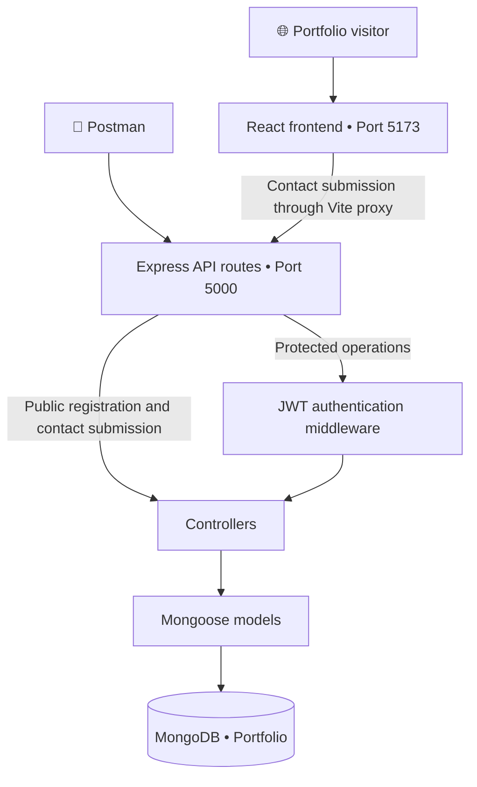
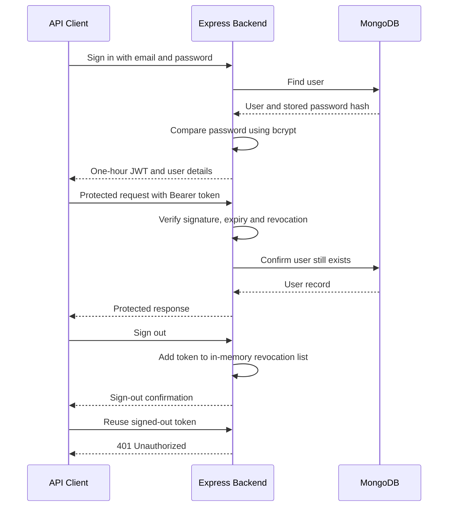

# 💻 Full Stack Portfolio Application

### React · Node.js · Express · MongoDB · JWT

**Vithusan Varatharajan**  
Centennial College · COMP229 Web Application Development  
Student ID: `301561437`

A personal portfolio that combines a React interface with an Express REST API and MongoDB storage. Built for COMP229 Assignment 2, this project extends my Assignment 1 portfolio with persistent contact submissions, CRUD operations and JWT authentication.

---

## 📌 Project Overview

Visitors can explore my background, skills, projects, education and services through the portfolio website. Contact form submissions are sent to the backend and stored in MongoDB.

The backend also provides APIs for managing contacts, projects, qualifications and users.

| Feature | Implementation |
| :--- | :--- |
| 🎨 Portfolio interface | Six React views with responsive styling |
| 📬 Contact submissions | Form data saved to MongoDB with a success confirmation |
| 🗃️ Database | Four collections with Mongoose schemas and validation |
| 🔄 REST API | Six CRUD operations per collection — 24 endpoints |
| 🔐 Authentication | JWT sign-in, sign-out and protected routes |
| 🔑 Password storage | Passwords hashed with bcrypt and excluded from API responses |
| 🧪 API testing | Postman collection and automated integration tests |
| ⚡ Development | Frontend and backend run together through one command |

> **Application scope:** The contact form is connected to MongoDB. The Projects and Education pages display the original frontend content, while their CRUD APIs are tested separately. Authentication is implemented through the API; the website does not include an administration or sign-in interface.

---

## 🏗️ Application Architecture



### How the layers work together

| Layer | Responsibility |
| :--- | :--- |
| **React** | Displays portfolio content, manages navigation and submits the contact form |
| **Express routes** | Match each HTTP method and URL to its controller |
| **Authentication middleware** | Verifies Bearer tokens before allowing protected requests |
| **Controllers** | Process requests and perform database operations |
| **Mongoose models** | Define document fields, validation and password hashing |
| **MongoDB** | Stores the application’s documents |

---

## 🛠️ Technology Stack

| Category | Technologies |
| :--- | :--- |
| **Frontend** | React, Vite, JavaScript, CSS |
| **Backend** | Node.js, Express |
| **Database** | MongoDB, Mongoose |
| **Authentication** | JSON Web Tokens, bcryptjs |
| **Configuration** | dotenv, CORS |
| **Development tools** | concurrently, nodemon, ESLint |
| **Testing** | Postman, Supertest, Node.js test runner, mongodb-memory-server |
| **Version control** | Git and GitHub |

---

## 🖥️ Portfolio Views

| View | Purpose |
| :--- | :--- |
| 🏠 **Home** | Introduction, technical skills and project navigation |
| 👤 **About Me** | Background, profile image and résumé |
| 🛠️ **Projects** | Selected software and cloud projects |
| 🎓 **Education** | Education and qualifications |
| 💼 **Services** | Areas of technical interest and services |
| ✉️ **Contact Me** | Contact form connected to the backend |

### Contact submission flow

1. A visitor completes the contact form.
2. React sends a `POST /api/contacts` request.
3. Mongoose validates and saves the document.
4. The backend returns `201 Created`.
5. React displays a confirmation after the save succeeds.

> Contact messages are saved to the database. The application does **not** send an email.

---

## 🚀 Run Locally

### Prerequisites

- Node.js **22.12+**, or a compatible newer version.
- npm.
- MongoDB Atlas or a running local MongoDB server.
- Postman for manual API testing.

### 1️⃣ Open the project

Open the **MyPortfolio** folder in VS Code.

This is the folder containing:

- `package.json`
- `server.js`
- `client`
- `config`
- `server`

### 2️⃣ Install dependencies

Run these commands from the project root:

```powershell
npm.cmd install
npm.cmd install --prefix client
```

| Command | Purpose |
| :--- | :--- |
| `npm.cmd install` | Installs backend and test dependencies |
| `npm.cmd install --prefix client` | Installs frontend dependencies |

On macOS or Linux, use `npm` instead of `npm.cmd`.

### 3️⃣ Configure environment variables

Create your local configuration file:

```powershell
Copy-Item .env.example .env
```

Edit the root `.env` file:

```dotenv
PORT=5000
MONGODB_URI=mongodb://127.0.0.1:27017/Portfolio
JWT_SECRET=replace-with-your-own-random-secret-at-least-32-characters
CLIENT_ORIGIN=http://localhost:5173
```

| Variable | Description |
| :--- | :--- |
| `PORT` | Port used by the backend |
| `MONGODB_URI` | MongoDB connection string |
| `JWT_SECRET` | Your own random signing secret, at least 32 characters long |
| `CLIENT_ORIGIN` | Allowed frontend origin |

For **MongoDB Atlas**, replace `MONGODB_URI` with your cluster’s driver connection string. Configure a database user and network access for your current IP address.

The backend explicitly selects the database named **Portfolio**.

> 🔒 Keep real database credentials and JWT secrets in `.env`. This file is excluded from Git. Commit `.env.example` as the configuration template.

### 4️⃣ Start the application

```powershell
npm.cmd run dev
```

This starts Vite and the backend together using **concurrently** and **nodemon**.

| Service | Address |
| :--- | :--- |
| 🌐 React frontend | http://localhost:5173 |
| ⚙️ Express backend | http://localhost:5000 |

Expected backend messages:

```text
Connected to MongoDB database: Portfolio
Portfolio backend running at http://localhost:5000
```

Keep the terminal running while using the application. Press **Ctrl+C** to stop it.

### Run only the backend

```powershell
npm.cmd start
```

### Welcome response

Opening `http://localhost:5000` returns:

```json
{
  "message": "Welcome to my Portfolio application."
}
```

---

## 🗃️ Database Design

**Database name:** `Portfolio`

The application uses four independent collections. The current schemas do not define relationships between them.

| Collection | Fields | Behaviour |
| :--- | :--- | :--- |
| **contacts** | `firstname`, `lastname`, `email`, `phone`, `message` | First name, last name and email are required; phone and message are optional in the API schema |
| **projects** | `title`, `firstname`, `lastname`, `email`, `completion`, `description` | Required fields with email validation and a completion date |
| **qualifications** | `title`, `firstname`, `lastname`, `email`, `completion`, `description` | Uses the permitted alternative to an `educations` collection |
| **users** | `name`, `email`, `password`, `created`, `updated` | Unique email, bcrypt password hashing and automatic timestamps |

### Data handling

- Text fields use Mongoose `String` types.
- Completion dates use the `Date` type.
- User `created` and `updated` timestamps are maintained automatically.
- Passwords are hashed before saving, including password changes.
- Password hashes are omitted from user API responses.
- Controllers accept only declared writable fields.

---

## 🔄 REST API

**Base URL:** `http://localhost:5000`

Each resource supports the following six operations:

| Method | Endpoint | Action | Success response |
| :--- | :--- | :--- | :--- |
| `POST` | `/api/{resource}` | Create a document | `201 Created` |
| `GET` | `/api/{resource}` | List documents | `200 OK` |
| `GET` | `/api/{resource}/{id}` | Read a document by ID | `200 OK` |
| `PUT` | `/api/{resource}/{id}` | Update supplied allowed fields | `200 OK` |
| `DELETE` | `/api/{resource}/{id}` | Delete a document by ID | `200 OK` |
| `DELETE` | `/api/{resource}` | Delete all documents in the collection | `200 OK` |

Replace `{resource}` with:

| Resource | Base endpoint |
| :--- | :--- |
| 📬 Contacts | `/api/contacts` |
| 🛠️ Projects | `/api/projects` |
| 🎓 Qualifications | `/api/qualifications` |
| 👤 Users | `/api/users` |

**Four resources × six operations = 24 CRUD endpoints.**

### Public endpoints

These operations do not require a token:

- `GET /` — welcome response.
- `POST /api/contacts` — submit a contact message.
- `POST /api/users` — register a user.
- `POST /api/auth/signin` — sign in.

All other CRUD operations require a valid Bearer token.

### Example contact request

```http
POST /api/contacts
Content-Type: application/json
```

```json
{
  "firstname": "Demo",
  "lastname": "Student",
  "email": "demo@example.com",
  "phone": "416-555-0100",
  "message": "Hello from the portfolio contact form."
}
```

### Error responses

| Status | Meaning |
| :--- | :--- |
| `400 Bad Request` | Invalid input, malformed JSON or an invalid document ID |
| `401 Unauthorized` | Missing, invalid, expired or revoked authentication |
| `404 Not Found` | Requested record or route was not found |
| `409 Conflict` | A user email already exists |
| `500 Internal Server Error` | An unexpected server error occurred |

---

## 🔐 JWT Authentication

### Authentication endpoints

| Method | Endpoint | Purpose |
| :--- | :--- | :--- |
| `POST` | `/api/users` | Register a user |
| `POST` | `/api/auth/signin` | Verify credentials and issue a JWT |
| `GET` | `/api/auth/me` | Retrieve the authenticated user |
| `POST` | `/api/auth/signout` | Revoke the supplied token |

### Authentication lifecycle



### Accessing protected routes

Include this header:

```http
Authorization: Bearer YOUR_JWT_TOKEN
```

### Current authentication scope

This project demonstrates authentication for coursework:

- Registered users can manage all records.
- Administrator roles and record ownership restrictions are not implemented.
- Token revocation is stored in server memory.
- Restarting the server clears the revocation list.

A production implementation would need persistent revocation, stronger authorization and additional abuse controls.

---

## 🧪 Testing

### Postman collection

Import:

```text
Portfolio.postman_collection.json
```

The collection includes requests for authentication and all **24 CRUD endpoints**.

| Collection variable | Purpose |
| :--- | :--- |
| `baseUrl` | Backend address; defaults to `http://localhost:5000` |
| `token` | JWT stored automatically after successful sign-in |
| Resource ID variables | IDs stored after creation for later requests |

### Recommended request order

1. Run **Welcome**.
2. Register the demo user.
3. Sign in.
4. Test the protected current-user endpoint.
5. Sign out.
6. Confirm that the signed-out token receives `401 Unauthorized`.
7. Sign in again to obtain a fresh token.
8. Test contacts, projects and qualifications.
9. Test users last.

Within each resource folder, run:

**Create → List → Read by ID → Update → Delete by ID → Delete all**

> ⚠️ Use an isolated assignment database. The **Delete all** requests remove documents from the selected collection. Test users last because deleting users removes the accounts needed for authentication.

If registration returns `409 Conflict`, use a fresh dummy email consistently in the registration and sign-in requests.

### Automated integration tests

```powershell
npm.cmd test
```

The suite checks:

- CRUD operations across all four resources.
- Required-field validation.
- Invalid IDs and missing records.
- Password hashing and password changes.
- Protected routes.
- JWT sign-in and sign-out behaviour.

Tests use a temporary MongoDB instance separate from the Atlas database. The first run may download a MongoDB binary and require internet access.

### Frontend checks

```powershell
npm.cmd run build --prefix client
npm.cmd run lint --prefix client
```

---

## 📂 Project Structure

| Path | Responsibility |
| :--- | :--- |
| `client/src/` | React components, styles and portfolio assets |
| `client/vite.config.js` | Frontend configuration and development API proxy |
| `config/config.js` | Root environment loading and server configuration |
| `server.js` | Database connection, model initialization and server startup |
| `server/express.js` | Express application, middleware and route registration |
| `server/models/` | Separate Mongoose models for each resource |
| `server/controllers/` | CRUD operations, authentication and error handling |
| `server/routes/` | Resource and authentication routes |
| `server/middleware/auth.js` | JWT verification and token revocation |
| `tests/api.test.js` | Automated API integration tests |
| `Portfolio.postman_collection.json` | Postman requests and response assertions |
| `.env.example` | Environment configuration template |
| `.gitignore` | Excludes credentials and installed dependencies |

---

## 📚 Course Starter Adaptation

This implementation adapts the provided **MyPortfolioBNew1** class starter and replaces its sample frontend with my Assignment 1 React portfolio.

The backend retains the starter’s organization:

- Root `server.js`.
- `config/config.js`.
- `server/express.js`.
- Separate model, controller and route files.

The contact and user controllers follow the starter’s create, list, read, update, remove and ID lookup pattern.

The project extends that foundation with:

- Project and qualification APIs.
- Delete-all operations.
- JWT authentication and protected routes.
- Password hashing.
- Environment-based configuration.
- Automated integration tests.

The starter’s undefined contact responses and conflicting welcome route were also corrected.

---

## 📦 Assignment Submission

The submission consists of:

| Item | Contents |
| :--- | :--- |
| **Project ZIP** | Frontend, backend, configuration template, tests and Postman collection |
| **GitHub repository** | Project source code and documentation |
| **Word evidence document** | Actual application, database and API testing screenshots |

Installed `node_modules` directories and the real `.env` file are excluded from the source package.

---

## 👨‍💻 Author

**Vithusan Varatharajan**  
Software Engineering Student · Centennial College  
COMP229 — Web Application Development

[GitHub Profile](https://github.com/vithusanvara) · [Project Repository](https://github.com/vithusanvara/COMP229-Assignment2-Portfolio)
